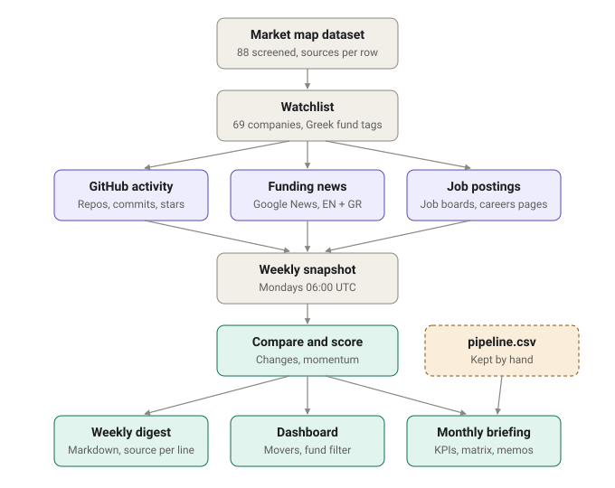

# Greek Deep Tech Deal-Flow Tracker

A weekly "what changed" tracker for the 69 companies on the [Greek Deep Tech Market Map](https://github.com/geve-ops/greek-deeptech-market-map). It watches four public signals: funding news, EU grants, new job postings and GitHub activity. Each run produces a Markdown digest, a dashboard and a monthly briefing. Every item links to its source.



Author: Gerald Velas. First digest: 26 October 2026.

| Output | File |
|---|---|
| Watchlist (69 companies, with LinkedIn, GitHub and job sources) | [data/watchlist.csv](data/watchlist.csv) |
| Weekly digests | [digests/](digests/) |
| Dashboard (live) | [geve-ops.github.io/vc-dealflow-tracker](https://geve-ops.github.io/vc-dealflow-tracker/) ([source](docs/index.html)) |
| Raw weekly snapshots | [data/snapshots/](data/snapshots/) |
| Momentum score history | [data/scores.csv](data/scores.csv) |
| Monthly briefing (live) | [geve-ops.github.io/vc-dealflow-tracker/briefing.html](https://geve-ops.github.io/vc-dealflow-tracker/briefing.html), archive in [docs/briefings/](docs/briefings/) |
| Analyst pipeline (For the moment kept by hand) | [data/pipeline.csv](data/pipeline.csv) |
| Backtest of GitHub activity before known rounds | [data/backtest.csv](data/backtest.csv) |

## How it works

1. **Watchlist.** `data/watchlist.csv` holds the market map rows with `map_status` Include or Borderline (36 + 33 = 69). `company_id` matches the market map dataset.
2. **Enrichment.** `linkedin_url`, `github_org`, `careers_url` and the job source are filled from public pages. Each value has a `*_source` column that says where it came from.
3. **Collection.** Each run calls every signal for every company and saves a dated snapshot in `data/snapshots/YYYY-MM-DD.json`.
4. **Digest.** The newest snapshot is compared with the one before it. Changes go to `digests/YYYY-MM-DD.md` and `docs/index.html`.
5. **Score.** Each company gets a weekly score from its changes, and a momentum score that adds earlier weeks at a lower weight. The digest opens with the top movers and a summary for each target fund; the dashboard can be filtered by Greek fund.

## Running it

Python 3.10 or newer. Standard library only, so there is nothing to install.

```
python run.py weekly
```

That collects all signals and writes the digest and the dashboard. Other commands:

```
python run.py build-watchlist --source ../greek-deeptech-market-map/data/greek_deeptech_dataset.csv
python run.py enrich                 # fill empty LinkedIn / GitHub / careers fields
python run.py enrich --only GRDT-037 # one company
python run.py collect --signals github news grants
python run.py digest                 # rebuild the digest from saved snapshots
python run.py backtest               # GitHub activity before known rounds (occasional; a few minutes)
```

Open `docs/index.html` in a browser to see the dashboard locally. The live version is served by GitHub Pages from the `docs/` folder on `main` and updates with each weekly run.

GitHub API calls use `GITHUB_TOKEN` if it is set, or the token of a logged-in `gh` CLI. Without a token the API allows 60 requests an hour, which is not enough for a full run.

**Schedule.** [.github/workflows/weekly.yml](.github/workflows/weekly.yml) runs `python run.py weekly` every Monday at 06:00 UTC and commits the new snapshot, scores, digest, dashboard and briefing. You can also start it by hand from the Actions tab. A manual run on 26 October 2026 confirmed that GitHub, Google News, the job boards and CORDIS all answer from GitHub's servers.

## Monthly briefing

`docs/briefing.html` is an executive view of the watchlist. Every weekly run regenerates it. Each run also saves a copy in `docs/briefings/YYYY-MM.html`, which later runs in the same month replace, so the archive keeps one page per month.

It has six sections:
1. **Key numbers:** companies tracked; early-stage capital disclosed in the last 6 months; how many companies are backed by a target fund; the top sector by recent capital; EU grants signed in the last 6 months.
2. **Analyst commentary:** the top 3 companies to engage, red flags in the data, and pipeline gaps.
3. **Charts and tables:** the stage funnel, the raising-window vs hiring matrix, sector by stage, signal coverage by sector, recent EU grants, and the GitHub backtest.
4. **Pipeline table:** the companies from `data/pipeline.csv`, plus companies the data suggests that are not yet in that file.
5. **Memos:** for pipeline rows whose memo columns are filled in.
6. **Draft post:** a short monthly summary built only from figures on the page, with a copy button. Edit it before posting.

**Computed from the data:**
- Round amounts, dates, stages and investors, copied from the market map dataset into the watchlist.
- Open roles, momentum and Greek fund tags, from the weekly tracker.
- **Red flags:** taken from the dataset's `verification_status`, for example `UNVERIFIED`, conflicting sources, or a Greek link known only from profile pages.
- **Companies with no visible activity:** companies with no GitHub organisation, no job source and no recent funding news.

**Written by hand:** `data/pipeline.csv` holds the analyst layer: pipeline stage (Watch, Track, Engage, Diligence, Term sheet, Memo), recommendation, next action, owner, risk notes and memo notes. Edit it, and the next run picks it up.

**Raising-window matrix:**
- **Horizontal axis:** months since the last disclosed round. Most seed and Series A companies raise again 15 to 24 months later.
- **Vertical axis:** open roles.
- **Shown:** venture-stage companies with a dated USD round in the last 72 months. Companies whose amount is only in EUR or GBP, or is undisclosed, are listed under the chart instead of plotted.
- **Prime targets:** at least 15 months since the round and at least 3 open roles.
- **Engage candidates:** prime targets whose last round was $20M or less, the range where Greek funds lead or join.

**What the briefing does not show:**
- **Valuations:** no company has a public one.
- **TAM and burn rate:** not in the data.
- **Conversion rates:** nothing has reached diligence yet.
- **Recent capital:** only rounds with a USD figure in the dataset are summed. Rounds given only in EUR or GBP are listed by name, not converted.

## Greek fund tags

Each company is tagged with the Greek venture funds in its cap table, read from the `investors` column of the market map dataset. The sources for those investors are in the dataset's `source_link` column.

- **Target funds:** Big Pi Ventures (7 companies), Marathon VC (10), Metavallon VC (9), Velocity Partners (2), egg / Eurobank (none on the watchlist).
- **Other Greek funds, kept for context:** Genesis Ventures (9), Evercurious VC (5), Uni.Fund (3), Phaistos Investment Fund (1), Starttech Ventures (1).
- 39 of the 69 companies have at least one Greek fund.
- `greek_fund_status` is `exited (company acquired)` when the company was bought, as with Augmenta, Code BGP and Seervision. It is `exited (fund sold its stake)` when the fund sold its stake, as Metavallon did with Purposeful.
- **Limits:** the tags are only as complete as the market map's `investors` column. Small or undisclosed tickets, and funds listed only on portfolio pages, may be missing. The fund name patterns are in `tracker/watchlist.py`.

## Momentum score

The score turns the weekly changes into a ranking. Each signal is capped, so no single signal can dominate.

| Signal this week | Points |
|---|---|
| Funding headline | 5 each, max 10 |
| EU grant signed | 3 each, max 6 |
| Other press headline | 1 each, max 3 |
| New role posted | 1 each, max 5 |
| Commits, excluding bots (all repos together) | 1 for 1-4, 2 for 5-19, 3 for 20 or more |
| New public repo | 1 each, max 2 |
| Stars gained | 1 per 25, max 2 |

**Momentum** = this week's score + 0.5 × last week + 0.25 × two weeks ago + 0.125 × three weeks ago. Older activity counts less, so the top of the list shows what is moving now.

The weights are a judgement call, not a model fitted to past rounds. The GitHub backtest (below) supports keeping GitHub's weight low. Points by signal are saved every week in `data/scores.csv` so the weights can be checked against rounds that are later announced.

- **Bots:** commits by Dependabot, Renovate and other `[bot]` accounts are shown in the digest but score nothing.
- **Coverage bias:** companies with no GitHub organisation, job source or EU projects can only score through news. A low score therefore means "nothing visible", not "nothing happening".
- **First weeks:** a score from one weekly run only reflects that week. Momentum becomes meaningful after about four runs.

## Signals and their limits

### GitHub activity

- **Source:** GitHub REST API, public repos of the company's organisation.
- **Reported:** new public repos, commits pushed during the week (with a link to the latest commit), and star changes from week to week.
- **Coverage:** 22 of 69 companies have a public GitHub organisation that could be tied to them. Most hardware, biotech and defence companies have none, so no activity here does not mean no work.
- **Limits:**
  - Only public repos are visible.
  - Commits are counted up to 100 per repo per week (shown as "100+").
  - Bot commits (Dependabot, Renovate, `[bot]` accounts) are listed but do not score.
  - Star changes start from the second run.
- **Backtest:** `python run.py backtest` compares non-bot commits in the 6 months before each company's last dated round with the 6 months before that. On 26 October 2026, 8 of 15 companies had measurable history: activity rose for 3, stayed flat for 2 and fell for 3. In this sample public commits do not reliably rise before a round. Results are in `data/backtest.csv` and the briefing.

### Funding news

- **Source:** Google News RSS search, run twice: in English with funding terms (raises, funding, seed, Series A, acquisition, grant...) and in Greek (χρηματοδότηση, επένδυση, αντλεί, εξαγορά...).
- **Matching:** a headline is kept only if it contains one of the company's `news_terms`. These are exact phrases, editable in the watchlist; overrides for renamed or ambiguous names are in `tracker/watchlist.py`.
- **Tags:**
  - **Funding:** the headline itself uses funding language.
  - **Press:** the name is in the headline and the funding terms appear only in the article body. Expect partnerships, product news and leadership changes here.
- **Limits:**
  - Google News links are redirect links that open the original article.
  - Coverage of small Greek outlets is uneven.
  - Paywalled sources (Sifted, PitchBook, Crunchbase News) often appear late or not at all.
  - Names shared with other firms can still give false matches. Fix these by narrowing `news_terms`.
  - Headlines are not verified figures. Confirm a round from a primary source before adding it to the market map dataset.

### EU grants

- **Source:** CORDIS, the EU's public database of Horizon Europe and earlier research and innovation projects. Its search answers in JSON without a key.
- **Matching:** a project counts when one of the company's `news_terms` appears in the project title, summary or participant names. Participant legal names often differ from brand names (Solmeyea's is SOLMEGIA), so matching on the text is more reliable.
- **Reported:** projects that were not in last week's snapshot. On a first run, only projects signed inside the window are reported.
- **Coverage:** on 26 October 2026, 118 projects across 21 companies; 12 companies have a project signed since 2024. This is the signal that sees SMEs and hardware companies with no GitHub or job feed (for example Satways, Prisma Electronics, Altus LSA).
- **Limits:**
  - Amounts are the EU contribution to the whole project, not the company's share.
  - Only EU programmes in CORDIS. National grants (for example Greek RRF calls), ESA contracts and NATO DIANA are not included.
  - A company named in a project's text is not always a participant. Check the CORDIS page before quoting a project.

### Job postings

- **Job-board APIs (13 companies):** postings come from public job-board APIs (Workable, Ashby, Recruitee, Breezy; Lever, Greenhouse and Personio are also supported). These give exact open roles with links.
- **Careers-page heuristic (marked `*` on the dashboard):** for companies whose own careers page is the only source, the tracker records links whose text looks like a role title and whose URL looks like a single posting.
  - Many careers pages load roles with JavaScript and show nothing to this method. The dashboard then shows "–", not 0.
- **Not covered:**
  - LinkedIn job listings, because LinkedIn has no open API and blocks automated access.
  - Companies with no careers page.
- **Limits:**
  - On the first run only postings dated inside the week count as new.
  - From the second run on, new and closed roles are taken from the difference between snapshots.

## Watchlist columns

| Column | Meaning |
|---|---|
| `company_id`, `company`, `category`, `map_status`, `website` | From the market map dataset. Notes after the website URL are dropped. |
| `linkedin_url`, `linkedin_source` | 64 of 69 filled. 50 come from a link on the company website. The other 14 were found by web search on 26 October 2026 and matched on name, HQ and description. 5 have no company page that could be found; the source column says so. |
| `github_org`, `github_source` | Either linked from the company website, or a GitHub organisation whose profile lists the company's website domain. Name matches alone are not accepted. |
| `careers_url`, `jobs_source`, `jobs_source_ref` | The job board and its account slug, `careers_page` with its URL, or `none` with a reason (for example, a careers page that belongs to an acquiring parent company). |
| `news_terms` | Exact phrases a headline must contain, separated by ` \| `. |
| `sub_sector`, `what_they_do`, `hq_greek_link`, `stage`, `last_round_amount`, `last_round_date`, `investors`, `verification_status` | Copied from the market map dataset by `build-watchlist`, for the briefing. Rebuild the watchlist after the dataset changes. |
| `greek_funds`, `greek_fund_status`, `greek_funds_source` | Greek funds in the cap table, separated by ` \| `, and whether the fund is still invested. Rebuilt from the market map each time `build-watchlist` runs. |

Values set by hand are not overwritten by `enrich` unless you pass `--force`.

## Repo layout

```
run.py                      command line entry point
tracker/watchlist.py        build the watchlist from the market map CSV
tracker/enrich.py           fill LinkedIn, GitHub and job sources
tracker/signals_github.py   GitHub signal
tracker/signals_news.py     funding news signal
tracker/signals_jobs.py     job postings signal
tracker/signals_grants.py   EU grants signal (CORDIS)
tracker/backtest.py         GitHub activity before known rounds
tracker/collect.py          run all signals, save a snapshot
tracker/score.py            weekly score and momentum ranking
tracker/digest.py           compare snapshots, write the digest and dashboard
tracker/briefing.py         monthly briefing from the watchlist, signals and pipeline file
tracker/briefing_template.html
tracker/dashboard_template.html
```
